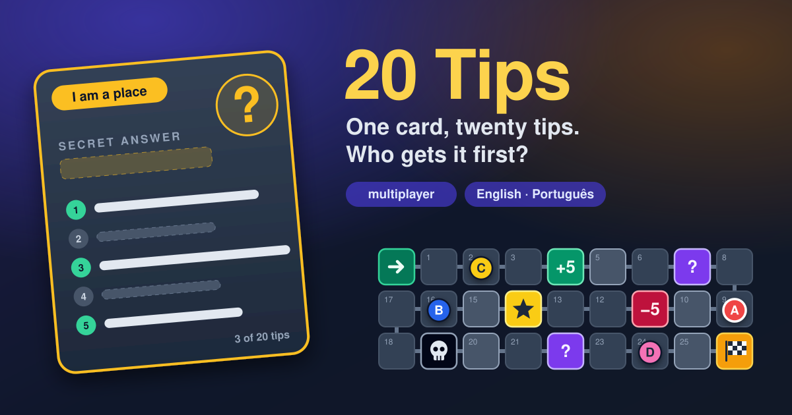

# 20 Tips / 20 Dicas



A web multiplayer guessing game in the style of *20 Questions* and the Brazilian board game *Perfil*.

One player holds a card — a **thing**, a **person**, a **place** or a **year** — with 20 tips.
The other players take turns revealing tips and trying to guess what the card is.
The interface and the cards are available in **English** and **Brazilian Portuguese**.

## Rules

1. Players meet in a room (one creates it and shares the 4-letter code or the invite link). 2 to 12 players.
   In the room each player can pick the colour of their token; a colour somebody already has cannot be picked.
2. Each round one player holds a card and sees its answer and all 20 tips.
3. The other players take turns. On your turn you pick a tip number; that tip is shown to everybody and
   you may make **one guess** or pass. Then the turn goes to the next player.
4. When somebody gets it right after *n* tips:
   - the guesser moves **20 − n** spaces,
   - the card holder moves **n** spaces.
   Example: a right guess after 5 tips moves the guesser 15 spaces and the card holder 5.
5. If all 20 tips are shown and nobody gets it, the card holder moves 20 spaces.
6. The card goes to the next player. The first player to reach the end of the track (60 spaces by default) wins.

### Game options

In the room, everybody sees the options of the next game (board size and how many special spaces of each kind).
The host changes them with the **Change** button, which opens the options window:

- **Spaces to win (board size)**: 30, 60, 100 or 150.
- **How the special spaces are placed**:
  - **At random** (the default): drawn at random when the game starts, in the numbers set below.
  - **On my own board**: the host gets a copy of the board and places the special spaces. Each click on a space
    turns it into the next kind: normal → individual question → back 5 → forward 5 → dead place → instant win →
    normal. The start and the finish can't be changed. "Start from a random board" fills it at random with the
    default numbers; "Clear the board" empties it. Changing the board size keeps the special spaces that still fit.
    The host's board is kept (also while "At random" is chosen) for the next games in the room.
- **Special spaces** (random boards): how many of each kind. They start at the default numbers (below), and go back to the
  defaults for the new size every time the board size is changed. "Back to the defaults" does the same by hand.
- The special spaces can never be more than the spaces between the start and the finish (29 on a board of 30);
  the window stops at that number, and the server refuses more.

- **Points** (second page of the window): how many spaces players move.
  - Normal rounds: for a right guess after 1, 2, … 20 tips, how far the guesser moves and how far the card holder
    moves (standard: guesser 20 − tips, card holder = tips).
  - Nobody gets it after all 20 tips: how far the card holder moves (standard: 20).
  - Individual question: for a right answer after 1 to 5 tips, how far the player answering moves
    (standard: 10, 8, 6, 4, 2). The card holder never moves in an individual question.
  - Each score is a whole number from 0 to 300. "Back to the standard points" resets them. Changing the board size
    does not change the points.

- **Time** (third page): a limit for picking a tip and a limit for making a guess, each 15, 30, 60 or 120 seconds,
  or no limit (the default).
  - Time to pick a tip runs out: a tip is picked at random, and the player can then guess.
  - Time to guess runs out: the player passes automatically.
  - Everybody sees the countdown. Each turn gets the full time. The clock is kept by the server, waits for a
    player who is away, and also applies to individual questions.

The other players see a summary in the room (including whether the points are the standard ones) and can open the
same window to look, without changing anything. The options are kept for the next game in the same room.

### Special spaces

When a game starts, some spaces of the board become special, at random (never the start or the finish).
How many of each is set in the game options; the defaults are in the table. The legend under the board explains them:

| Space | How many | What it does |
| --- | --- | --- |
| ❓ Individual question | default: 1 for every 15 normal (not special) spaces | After the round, that player answers a new card alone, with at most 5 tips. Another player, drawn at random, holds the card (and can count a refused answer as right). Right after 1 tip: 10 spaces, 2: 8, 3: 6, 4: 4, 5: 2 (or the points set in the game options). A miss moves nobody, and the card holder never moves. |
| −5 Move back 5 | default: 1 for every 20 normal (not special) spaces | Go back 5 spaces (never behind the start). |
| +5 Move forward 5 | default: 1 for every 20 normal (not special) spaces | Go forward 5 spaces (reaching the finish wins). |
| 💀 Dead place | default: 1 | Go back to the start. |
| 🏆 Instant win | default: 1 | Go to the finish and win. |

By default, a track of 30 has 1 of each kind; for 60: 3 individual questions, 2 "back 5", 2 "forward 5", 1 dead place
and 1 instant win; for 100: 5, 4, 4, 1, 1; for 150: 8, 6, 6, 1, 1.

A special space only acts on a player who lands on it by moving in a normal round — with a right guess or as the
card holder. It does nothing to a player moved there by another special space or by an individual question.
When several players land on individual questions in the same round, their questions are played one after the
other, before the next normal round; the card then carries on going round the table as usual. A player who is
away when their individual question is due loses it, and if they drop out while answering, the host or the card
holder can skip the question.

During the game a board shows the whole track, from the start to the finish, as a path of numbered spaces.
Each player is a round token with the first letter of their name, in their colour, standing on the space of
their score; tokens slide along when players move.

Each round starts with the card holder **choosing the card**: they can **skip** it (too easy, too hard…) and draw
another as many times as they like, then press **Use this card**. Only then can the other players pick tips (and
only then does a time limit start). After that the card can no longer be skipped. The other players see how many
cards were skipped. This also applies to whoever holds the card of an individual question.

While choosing the card, the holder can also play **a card of their own** ("My own cards"): they write a category,
an answer, optionally other accepted answers, and the 20 tips. Own cards are kept in the browser's local storage —
everything typed is saved at once, unfinished cards included — and the list is there to pick from in every round
(and to prepare in the room before the game). A card can be used once it has an answer and all 20 tips; it is shown
to everybody as written, whatever their language, and the others are told the card was written by the holder.

**Writing a card automatically.** In the own-card form, **✨ Fill automatically** asks an AI service to write the
card: it uses the category and, if one was typed, the answer (otherwise the AI picks one), in the player's language.
The server checks what comes back: it tidies numbering, drops tips that give the answer away or repeat, keeps 20,
asks once more if the reply is not a usable card, and reports the problem if it still is not. Fewer than 20 good tips
fill what they can and say so. The button only appears when the server has a key set up (see below).

**Cards are not repeated for a player.** Each browser remembers, in its local storage, the cards its player has
already seen (held, or seen answered), and sends that list when joining a room. The server then draws cards that
none of the players in the room has seen — or, when there are none left, the ones seen by the fewest of them — and
never repeats a card in the same room until every card has been used. Once a player has seen every card, their list
is emptied and they start again.

Guesses are checked automatically, ignoring capitals, accents, a leading article and small typos, and are
accepted in either language. If a guess was right but the computer refused it (an unusual spelling, another
name for the same thing), the card holder can press **Count as right**.

If a player's connection drops or they reload the page, their seat and score are kept and they come back
to the same game automatically. If the card holder leaves, the round is cancelled without points.

## Project layout

```
backend/    Node + TypeScript game server: Express (HTTP), socket.io (multiplayer), i18n (translations), Jest (tests)
  src/game/         the rules (Game.ts), answer checking (answer.ts), rooms (RoomManager.ts)
  src/cards/data/   the cards, one JSON file per category
  src/locales/      server messages in en and pt-BR
  src/server.ts     Express + socket.io wiring
  tests/            Jest tests
frontend/   Vue 3 + TypeScript app: Tailwind CSS (styling), socket.io-client, vue-i18n (translations), Jest (tests)
  src/components/   the screens
  src/locales/      interface texts in en and pt-BR
  src/store.ts      talks to the server and keeps the current game state
  src/board.ts      where the spaces and tokens of the board go; src/colors.ts has the token colours
  tests/            Jest tests
```

## Requirements

- Node.js 22 or newer (npm comes with it)

Install the dependencies of both parts once:

```bash
npm run install:all
# which is the same as:
#   cd backend  && npm install
#   cd frontend && npm install
```

## Running while developing

Use two terminals:

```bash
# terminal 1 – game server on http://localhost:3000, restarts when a file changes
cd backend
npm run dev

# terminal 2 – the app on http://localhost:5173, updates in the browser as you edit
cd frontend
npm run dev
```

Open **http://localhost:5173**. To try multiplayer on one computer, open a second window in private
(incognito) mode or another browser — each one is a different player.

The frontend dev server passes `/api` and the socket.io connection on to the game server, so the browser only
talks to port 5173. If the game server runs somewhere else, say so when starting the frontend:
`BACKEND_URL=http://localhost:4000 npm run dev`.

### Tests and checks

```bash
cd backend  && npm test        # rules, answer checking, cards, translations, a real socket.io round
cd frontend && npm test        # translations, state handling, screens

cd backend  && npm run typecheck
cd frontend && npm run typecheck
```

`npm test` in the top folder runs both test suites.

## Running in production

In production a single Node process serves everything — the built app, the API and the socket.io
connection — on one port.

```bash
# 1. install (once, or after pulling changes)
npm run install:all

# 2. build the app (frontend/dist) and the server (backend/dist)
npm run build

# 3. start
NODE_ENV=production PORT=3000 npm start
```

Then open `http://<your-server>:3000`.

Settings (environment variables of the server):

| Variable        | Default            | Meaning                                                                 |
| --------------- | ------------------ | ----------------------------------------------------------------------- |
| `PORT`          | `3000`             | Port to listen on                                                       |
| `HOST`          | `0.0.0.0`          | Address to listen on                                                    |
| `FRONTEND_DIST` | `../frontend/dist` | Folder with the built app, if it is not in its usual place              |
| `LLM_API_KEY`, `LLM_BASE_URL`, `LLM_MODEL`, `LLM_JSON_MODE`, `LLM_TIMEOUT_MS` | *(none / Groq)* | The AI service for "Fill automatically" (see below); also read from `backend/.env` |
| `TRUST_PROXY`   | *(none)*           | Number of proxies in front of the server (`1` on Render), so that it sees each visitor's own address |
| `CORS_ORIGIN`   | *(none)*           | Comma-separated addresses allowed to connect, only needed when the app is served from a different address than the server |

Notes for a real deployment:

- Keep the process alive with a process manager, for example `pm2 start backend/dist/index.js --name 20-tips`
  or a systemd service.
- Behind a reverse proxy (nginx, Caddy…), WebSocket upgrades must be passed through for `/socket.io/`.
- Games live in the memory of the one server process: restarting it ends the games in progress, and it
  cannot be spread over several processes without adding a shared store (for example the socket.io Redis adapter).

## Putting it online with Render (Docker)

The repository has a `Dockerfile` that builds one image serving the app, the API and the socket.io connection,
and a `render.yaml` ("Blueprint") that tells [Render](https://render.com) how to run it.

1. Put the project in a Git repository on GitHub or GitLab (Render deploys from there).
2. In Render: **New → Blueprint**, connect the repository. Render reads `render.yaml`, asks for the secret
   `LLM_API_KEY` (leave it empty unless you want "Fill automatically"), builds the image and starts it.
3. The game is then at the `https://<name>.onrender.com` address Render shows. Every push to the repository
   redeploys it.

What `render.yaml` sets: a Docker web service on the free plan, in the Virginia region, one instance, health check
on `/api/health`, `NODE_ENV=production`, `TRUST_PROXY=1` (Render has a proxy in front, and this lets the server
tell visitors apart), and the AI service variables. Render provides `PORT` itself; the server listens on it.

Things to know:

- On the free plan the service goes to sleep after about 15 minutes without visitors. The next visit wakes it up
  (this can take up to a minute), and games that were in progress are gone, because games live in memory.
- Keep a single instance for the same reason.
- WebSockets work on Render without extra settings.

To try the image on your own machine (with Docker installed):

```bash
docker build -t twenty-tips .
docker run --rm -p 3000:3000 -e PORT=3000 twenty-tips     # then open http://localhost:3000
```

The illustration at the top of this page is `frontend/public/illustration.svg`; it is also served by the app at
`/illustration.svg`.

## Setting up "Fill automatically" (AI service)

The server talks to any service with an OpenAI-style chat API. Groq has a free tier and is the default; Google
Gemini and OpenRouter (models ending in `:free`) work too. The key stays on the server and is never sent to
browsers.

1. Create an account with the service and create an API key (for Groq: https://console.groq.com → **API Keys** →
   **Create API Key**; copy it straight away, it is shown once).
2. Copy `backend/.env.example` to `backend/.env` and put the key after `LLM_API_KEY=`. For Gemini or
   OpenRouter also change `LLM_BASE_URL` and `LLM_MODEL` (the example file lists them).
3. Restart the server. `GET /api/cards/generate` then answers `{"available":true}` and the button appears.

Instead of the `.env` file the same names can be set as environment variables. The server machine needs internet
access to reach the service. Each address may ask for 5 cards a minute. Failures are written to the server's log
("card generator: …") with the reason.

## Adding cards

Cards are in `backend/src/cards/data/*.json`. Each file is a list of cards like this:

```json
{
  "id": "place-eiffel-tower",
  "category": "place",
  "answer": { "en": "Eiffel Tower", "pt": "Torre Eiffel" },
  "aliases": { "en": ["tour eiffel"], "pt": [] },
  "tips": { "en": ["…20 tips…"], "pt": ["…20 dicas…"] }
}
```

- `category` is `thing`, `person`, `place` or `year`.
- There must be exactly 20 tips in each language, in the same order (tip 7 in Portuguese is the translation
  of tip 7 in English).
- `aliases` are other answers that count as right.
- A tip must not contain the answer.

The server checks the cards when it starts and refuses to start with a malformed one; `npm test` in
`backend/` checks them too. Rebuild (or restart `npm run dev`) after changing cards.

The game ships with 54 cards: 14 things, 14 places, 14 people and 12 years. The facts in the tips were written
and reviewed from general knowledge, not checked against a reference source.

## Adding a language

1. Interface: add `frontend/src/locales/<code>.json` and register it in `frontend/src/i18n.ts`.
2. Server messages: add `backend/src/locales/<code>.json` and the code to `LOCALES` in `backend/src/types.ts`
   (then copy that file to `frontend/src/types.ts` — the two are kept identical, and a test checks it).
3. Cards: add the language to every card and map the locale to it in `cardLang` (`backend/src/game/Game.ts`).
